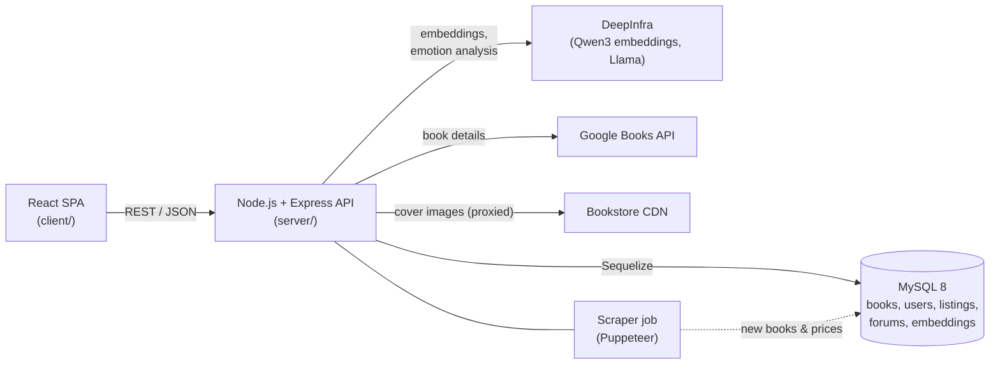

# Aurora Codex — a web app for readers, with AI recommendations
https://aurora-codex.vercel.app/
Aurora Codex brings together everything a Romanian reader needs in one place:

- a catalogue of **56,000+ books** with prices compared across Romanian bookstores;
- **AI recommendations** that understand what a book is about and its emotional tone;
- a **marketplace** for second-hand books, with private buyer–seller chats;
- **discussion forums**;
- **statistics** about the catalogue and the marketplace.

It was built as a Bachelor's thesis project. The interface is in Romanian; the code and the
documentation are in English.

> The demo runs on free hosting. The first visit after a long quiet period can take a minute
> while the services wake up; after that, the app keeps them awake while it is open.

---

## Features

| Area | What you can do |
|---|---|
| **Catalogue** | Search by title, filter by genre and price, sort, and open a book page with its description, emotional profile, store offers (cheapest first) and extra details (publisher, year, pages) from Google Books. |
| **Reading history** | Mark books as read and rate them from 1 to 5 stars; pick favourite genres. |
| **AI recommendations** | Describe what you feel like reading ("o poveste de dragoste în Parisul anilor '20") and optionally an emotional tone, or let the app use your ratings. Books are matched by meaning, not keywords. |
| **Marketplace ("Bazar")** | Sell books you've read: photo, price, condition, a link to the catalogue book. Buyers contact sellers in private chats (text, photos, PDFs). |
| **Forums** | Start discussions, reply, close your own threads. |
| **Statistics** | Charts of catalogue prices by genre and author, and of marketplace prices, each with a table view. |
| **Moderation** | Report listings, forums and messages; administrators review reports and can hide content or revoke a user's rights. |
| **Admin panel** | AI status and a connection test, background jobs with live progress (bookstore scraper, embeddings, emotion analysis), and every tunable setting. |
| **Everywhere** | Light and dark themes, responsive down to phone size, keyboard- and screen-reader-friendly components. |

## Architecture



- **Client:** a single-page React app. It talks only to the API; it never holds secrets.
- **Server:** a REST API. It owns the business rules, authentication, file uploads, the
  recommender, the background jobs and every call to external services (API keys stay server-side).
- **Database:** MySQL. The schema is managed by versioned migrations. Each book's embedding is
  stored as a vector in MySQL and searched through an in-memory index on worker threads.

### How the recommendations work

1. Every book (title, author, genre, description) is turned into a vector by a multilingual
   embedding model (`Qwen/Qwen3-Embedding-4B` on DeepInfra). Books about similar things end up close together.
2. A search is embedded the same way. Without a search, the reader's "taste" is the average
   vector of the books they rated 4–5 stars.
3. The closest books are re-ranked by the requested emotion (each book has scores for joy,
   fear, sadness… from a language model) and the reader's favourite genres. Books they already
   read are skipped.

Embeddings are generated once from the admin panel and stored in the database. A restart only reloads them
into memory, and new or changed books are picked up by the next run.

## Tech stack

| Layer | Technologies |
|---|---|
| Client | React 19, React Router 7, TanStack Query 5, Vite 6, CSS Modules with design tokens, Recharts, Vitest + Testing Library |
| Server | Node.js 20+, Express 4, Sequelize 6 + umzug migrations, JWT auth, Helmet, rate limiting, Multer + Sharp (image optimisation), worker threads, `node:test` |
| Data | MySQL 8 |
| AI | DeepInfra (OpenAI-compatible API): Qwen3-Embedding-4B, Llama 3.1 8B Instruct |
| Tooling | ESLint 9 (flat config) in both apps |

## Repository layout

```
client/        React single-page app                → see client/README.md
server/        REST API, recommender, jobs, scripts → see server/README.md
  docs/API.md  endpoint reference
```

## Getting started (local development)

**Requirements:** Node.js 20+ and MySQL 8.

1. **Database.** Create an empty database, e.g. `CREATE DATABASE aurora_codex CHARACTER SET
   utf8mb4 COLLATE utf8mb4_0900_ai_ci;`. Then either import a dump (see *Deployment*) or let the server create the
   schema with its migrations on first start.

2. **Server**
   ```powershell
   cd server
   copy .env.example .env      # set DB_*, SECRET_KEY and, for AI features, DEEPINFRA_API_KEY
   npm install
   npm run dev                 # http://localhost:3000
   ```

3. **Client**
   ```powershell
   cd client
   copy .env.example .env.local   # VITE_API_URL=http://localhost:3000
   npm install
   npm run dev                    # http://localhost:5173
   ```

4. **An administrator account.** Register in the app, then promote it:
   `npm run user -- make-admin <email or username>` (from `server/`).
   The same script lists accounts and resets forgotten passwords.

5. **AI features (optional).** With `DEEPINFRA_API_KEY` set, open the admin panel (`/admin`),
   run **Vectori semantici** (embeddings) and optionally **Analiză emoțională**.
   Recommendations appear automatically once embeddings exist.
   The whole catalogue costs about $0.55 to embed.

### Quick start with the demo database

The fastest way to see everything working is the ready-made demo database. It has the full
catalogue plus 20 demo readers with forums, listings and chats. It's attached to the
repository's [Releases](../../releases) as `aurora_codex.sql.gz`.

1. Download `aurora_codex.sql.gz` and unpack it (7-Zip on Windows, `gunzip` elsewhere).
2. Import it into an empty database:
   ```powershell
   mysql -u root -p --default-character-set=utf8mb4 -e "CREATE DATABASE aurora_codex CHARACTER SET utf8mb4 COLLATE utf8mb4_0900_ai_ci"
   mysql -u root -p --default-character-set=utf8mb4 aurora_codex -e "source aurora_codex.sql"
   ```
3. Set `DB_NAME=aurora_codex` in `server/.env` and start the server and the client (steps 2–3 above).
4. Give yourself access: `npm run user -- reset-password aurora_admin` (from `server/`) prints a
   new administrator password. Do the same for any demo reader you want to log in as, e.g.
   `npm run user -- reset-password cristina_reads`.

The listing photos aren't inside the dump. Without them the listings show a placeholder; to get
the photos, run `npm run db:seed-demo -- --reset` against the imported database (see below),
which regenerates the demo content and its photos.

### Building your own demo data

For a demo, the server can build a separate database with the catalogue and a believable community:
20 fictional readers and an administrator, plus ratings, forum threads, marketplace listings
with photos, conversations and reports.

```powershell
cd server
npm run db:create-catalogue -- --from <your database> --to aurora_codex
$env:DB_NAME = "aurora_codex"; $env:UPLOADS_DIR = "db/deploy/uploads"
npm run db:seed-demo     # writes the generated passwords to db/deploy/demo-accounts.local.txt
npm run db:export        # writes db/deploy/aurora_codex.sql
```

Everything under `server/db/deploy/` is git-ignored (dump, photos, credentials).

## Using the app

A short tour, as a reader and as an administrator.

**As a reader**

1. **Create an account** with *Conectează-te* → *Cont nou*. Browsing works without one;
   rating, selling, chatting and posting need an account.
2. **Find books** in *Cărți*. Search by title, filter by genre and price, sort by price or title.
   A book page shows the description, the cheapest store offers and its emotional profile.
3. **Rate what you've read:** pick 1–5 stars on a book page. Your ratings are in *Istoricul de
   lectură* (user menu), and they teach the recommender your taste.
4. **Get recommendations** in *Cărți* → *Recomandate pentru tine*:
   - *După profilul tău* uses your 4–5 star books;
   - *După ce cauți acum* takes a description of what you feel like reading, plus an
     optional emotional tone.
5. **Sell a book** in *Bazar* → *Publică un anunț*. Add a photo, a price and its condition, and
   link it to the catalogue book so buyers can compare with store prices. Manage your listings
   (change the price, mark as sold, delete) in *Anunțurile mele*.
6. **Buy a book:** on a listing, write a message under *Scrie-i vânzătorului*; it opens a private chat. Your
   conversations are in *Conversațiile mele*.
7. **Talk about books** in *Forumuri*: start a thread or reply. You can close your own threads.
8. **Report** anything inappropriate with the flag button on listings, forums and messages.

**As an administrator** (user menu → *Panou de administrare*)

- **Sarcini (jobs):**
  - check the AI connection;
  - run the **bookstore scraper** to add books and refresh prices;
  - run **Vectori semantici** to embed new or changed books;
  - run **Analiză emoțională** to score books without emotion scores.

  Each job shows live progress and can be stopped. Use a small *Limită* for a cheap test run.
- **Setări (settings):** models, the number of recommendations, how much the emotional tone
  counts, the scraper's speed… Every field explains itself and can be reset to its default.
- **Rapoarte (reports):** review reports, hide messages, delete listings or forums, and revoke
  a user's right to post, sell or message.

## Developing

### Daily workflow

```powershell
cd server; npm run dev      # API with auto-restart, http://localhost:3000
cd client; npm run dev      # app with hot reload, http://localhost:5173
```

Before you commit, run `npm run lint` and `npm test` in the folder you changed. Run
`npm run test:integration` in `server/` when you touched routes, services or the schema.

### Conventions

- **Language:** code, file names, the database schema, API fields and error messages are in
  English. Only what users see (UI text, genre labels) is Romanian.
- **Server layers:** a request flows **route → controller → service → model**.
  - Controllers validate input (`src/utils/validation.js`) and shape output (`src/serializers`).
  - Services hold the rules and throw `HttpError` (for example
    `HttpError.notFound('Listing not found')`); the central error handler turns those into JSON responses.
- **Client features:** each feature folder in `client/src/features/` has its own `api.js`
  (requests), `hooks.js` (TanStack Query hooks), `components/` and `pages/`.
  - Shared pieces live in `client/src/shared/` (UI kit, hooks, formatting).
- **Styling:** use CSS Modules next to each component, and the design tokens from
  `shared/styles/tokens.css` (`var(--space-4)`, `var(--color-primary)`…) instead of raw values.
  Dark mode then works automatically.
- **Secrets** belong in `server/.env` only; anything in the client's `VITE_*` variables is public.

### Adding a feature end to end

Say you want users to bookmark listings.

1. **Database:** add a migration in `server/src/database/migrations/` (next number,
   `export const up/down`). It runs automatically on the next start, or with `npm run db:migrate`.
2. **Model:** define it in `server/src/models/` and register it (and its associations) in `models/index.js`.
3. **Service:** write the logic in `server/src/services/…`, checking ownership and permissions there.
4. **API:** add a controller method, a route in `server/src/routes/` (with `authenticate` and a
   rate limiter if users write data) and a serializer for the response.
   - Document the endpoint in `server/docs/API.md`.
5. **Server tests:** unit tests in `server/tests/unit/`, and an end-to-end case in
   `server/tests/integration/api.test.js`.
6. **Client data:** add the calls to the feature's `api.js`, then hooks in `hooks.js`. Use
   `queryKeys` from `shared/lib/query-keys.js`, and invalidate the affected queries after mutations.
7. **UI:** build components from `@/shared/ui` (Button, Card, Modal, Input…). Add a route in
   `client/src/app/router.jsx` and its URL in `app/paths.js` (Romanian slug).
8. **Client tests:** next to the code, as `*.test.js(x)` (Vitest + Testing Library).

### Useful commands

| Where | Command | Purpose |
|---|---|---|
| server | `npm run db:status` / `db:migrate` / `db:rollback` | inspect and apply schema migrations |
| server | `npm run user -- list` · `reset-password <user>` · `make-admin <user>` | manage accounts |
| server | `npm run db:create-catalogue` · `db:seed-demo` · `db:export` | build and export a demo database |
| server | `LOG_LEVEL=debug`, `DB_LOGGING=true` in `.env` | verbose logs and every SQL query |
| client | `npm run build` then `npm run preview` | check the production build locally |

## Testing and quality

| | Command | What runs |
|---|---|---|
| Server | `npm run lint` · `npm test` | ESLint; unit tests (no database needed) |
| Server | `npm run test:integration` | End-to-end API tests on a throwaway MySQL database (`TEST_DB_NAME=<name>_test`) |
| Client | `npm run lint` · `npm test` · `npm run build` | ESLint; Vitest unit and component tests; production build |

## Deployment

The production setup:

- **API** on Render's free plan, defined in [`render.yaml`](render.yaml);
- **client** on Vercel;
- **uploads** (avatars, listing photos, chat files) on Cloudflare R2, in the `aurora-codex/` folder of a bucket;
- **MySQL** at any MySQL 8 host.

In production the settings are environment variables in each provider's dashboard, not `.env` files.

### 1. Database

Import the demo database from [Releases](../../releases) (`aurora_codex.sql.gz`, unpacked first):

```powershell
& "C:\Program Files\MySQL\MySQL Server 8.0\bin\mysql.exe" -h <host> -P <port> -u <user> -p --default-character-set=utf8mb4 <database> -e "source aurora_codex.sql"
```

### 2. Cloudflare R2

1. Create a bucket.
2. Under **Settings → Public access**, enable the r2.dev subdomain or connect a custom domain.
   This is `R2_PUBLIC_URL`.
3. Under **R2 → Manage API tokens**, create a token with *Object Read & Write* on that bucket.
   This gives `R2_ACCESS_KEY_ID` and `R2_SECRET_ACCESS_KEY`. `R2_ACCOUNT_ID` is shown on the
   R2 overview page.

Files are stored under `aurora-codex/images/` (public) and `aurora-codex/chat-media/` (private:
served only through the API, to the chat's participants).

### 3. API on Render

**New → Blueprint**, pick this repository, branch `main`, then fill in what it asks for:

| Variable | Value |
|---|---|
| `DB_HOST`, `DB_PORT`, `DB_NAME`, `DB_USER`, `DB_PASS` | your MySQL host |
| `FRONTEND_URL` | the Vercel URL, e.g. `https://your-app.vercel.app` |
| `R2_ACCOUNT_ID`, `R2_ACCESS_KEY_ID`, `R2_SECRET_ACCESS_KEY`, `R2_BUCKET`, `R2_PUBLIC_URL` | from step 2 |
| `DEEPINFRA_API_KEY`, `GOOGLE_BOOKS_API_KEY` | optional |

`SECRET_KEY` is generated by Render. `DB_SSL=true` is preset: set it to `false` if your MySQL
host doesn't support TLS. If it uses its own CA, add the CA as a Secret File `ca.pem` and set
`DB_SSL_CA_FILE=/etc/secrets/ca.pem`.

### 4. Client on Vercel

Import the repository with **root directory `client`**. Set
`VITE_API_URL=https://<your-service>.onrender.com`, then deploy. `vercel.json` already handles
client-side routes.

### 5. First login

The free Render plan has no Shell, so run this from `server/` on your computer, with the
production database details:

```powershell
$env:DB_HOST="<host>"; $env:DB_PORT="<port>"; $env:DB_NAME="<database>"; $env:DB_USER="<user>"; $env:DB_PASS="<password>"
npm run user -- reset-password aurora_admin
```

Log in as `admin.aurora.codex@example.com`.

To add the demo listing photos to R2, run `npm run db:seed-demo -- --reset` with the same
database variables plus the `R2_*` ones. It recreates the demo content and uploads the photos.

### Free-plan notes

- **Cold starts:** the API sleeps after 15 idle minutes. Two keep-alives prevent that while the app is in use:
  - every open browser tab pings the API's `/health` every 2–4 minutes;
  - the API pings the database every 2–4 minutes (`DB_KEEPALIVE*`).
- **No scraper on Render:** headless Chrome isn't installed (`PUPPETEER_SKIP_DOWNLOAD`). Run the
  scraper locally against the production database if you need it.

## Security

- **Secrets:** API keys (DeepInfra, Google Books) and the JWT secret live only in the server's
  environment. They're never sent to the browser and are redacted from logs.
- **Rate limits:** on every endpoint, with tighter per-user and global budgets for anything that
  calls the paid AI provider.
- **Validated input everywhere:**
  - uploads are checked by content, not just by name;
  - images are re-encoded;
  - cover images are proxied only from allowlisted HTTPS hosts.
- **Authorisation:** checked on the server for every action (owner-only edits; admin role read
  from the database). Passwords are hashed with bcrypt, and sessions expire unless the user is active.

## Documentation

- [client/README.md](client/README.md): client structure, styling system, conventions
- [server/README.md](server/README.md): server structure, migrations, AI recommender, scripts
- [server/docs/API.md](server/docs/API.md): every endpoint, plus the old → new route mapping
