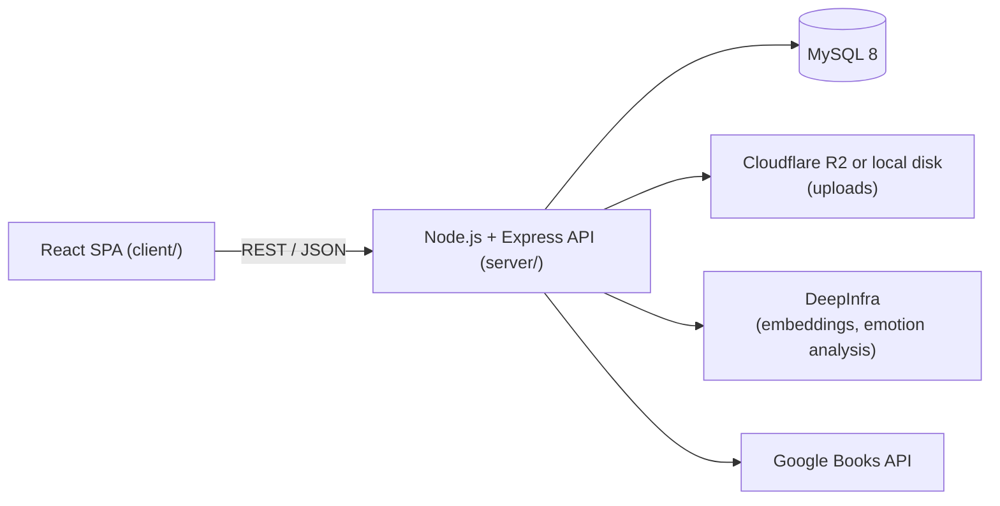

# Aurora Codex

**Live demo:** https://aurora-codex.vercel.app

A web app for Romanian readers: a catalogue of 56,000+ books with prices from Romanian bookstores,
AI recommendations, a second-hand book marketplace, discussion forums and statistics.
Built as a Bachelor's thesis project. The interface is in Romanian; code and documentation are in English.

> The demo runs on free hosting: the first request after a quiet period can take up to a minute.

## Features

| Area | Highlights |
|---|---|
| **Catalogue** | Search, genre and price filters; book pages with store offers, an emotional profile, Google Books details, similar books and related forum threads. Ratings from 1 to 5 stars and favourite genres build each reader's profile. |
| **AI recommendations** | From your ratings or from a description of what you feel like reading, with an optional emotional tone. Every pick says why it was made ("because you liked …"); "not interested" hides a book and steers future lists away from similar ones. |
| **Marketplace** | Listings with up to 6 photos, condition, city, pickup/courier, reserved and sold states; favourites; filters by condition, city and delivery; a price comparison with bookstores; private buyer–seller chats with attachments. |
| **Forums** | Categories, pinned and closed threads, numbered posts with quotes, likes, edits, simple formatting and view counts. |
| **Statistics** | Catalogue, marketplace and community charts, each with a table view. |
| **Moderation and admin** | Reports, hiding content, revoking user rights; an admin panel for the AI settings and background jobs (bookstore scraper, embeddings, emotion analysis) with live progress. |
| **Everywhere** | Light and dark aurora themes, responsive down to phone size, accessible components. |

## How it works



The client only talks to the API; every secret and external call stays on the server.

**Recommender.** Each book's title, author, genre and description is embedded once
(`Qwen/Qwen3-Embedding-4B`, 1024 dimensions) and stored in MySQL. At runtime the vectors live in
an in-memory int8 index searched by worker threads (about 0.1 s for 50k books). A reader's list
combines their overall taste (books rated 4–5) with each favourite book separately, so distinct
interests don't blur together. Books resembling ones they disliked or dismissed are pushed down,
and the result is re-ranked by emotional tone and favourite genres and diversified (at most two
per author). "Similar books" use the stored vectors only, so they cost nothing to serve.

## Tech stack

| Layer | Technologies |
|---|---|
| Client | React 19, React Router 7, TanStack Query 5, Vite 6, CSS Modules with design tokens, Recharts, Vitest + Testing Library |
| Server | Node.js 20+, Express 4, Sequelize 6 with umzug migrations, JWT, Helmet, express-rate-limit, Multer + Sharp, worker threads, `node:test` |
| Data and services | MySQL 8, Cloudflare R2, DeepInfra (Qwen3-Embedding-4B, Llama 3.1 8B Instruct), Google Books |

## Repository

```
client/            React app           → client/README.md
server/            REST API and scripts → server/README.md
server/docs/API.md endpoint reference
render.yaml        Render blueprint for the API
```

## Running locally

**Requirements:** Node.js 20+ and MySQL 8.

1. **Database.** The quickest start is the demo database from the
   [Releases](../../releases) page (`aurora_codex.sql.gz`: the full catalogue plus 20 demo readers).
   Unpack it, then:
   ```powershell
   mysql -u root -p --default-character-set=utf8mb4 -e "CREATE DATABASE aurora_codex CHARACTER SET utf8mb4 COLLATE utf8mb4_0900_ai_ci"
   mysql -u root -p --default-character-set=utf8mb4 aurora_codex -e "source aurora_codex.sql"
   ```
   An empty database works too: the server creates the schema on first start.

2. **Server**
   ```powershell
   cd server
   copy .env.example .env   # set DB_*, SECRET_KEY; DEEPINFRA_API_KEY is optional
   npm install
   npm run dev              # http://localhost:3000, applies pending migrations on start
   ```

3. **Client**
   ```powershell
   cd client
   copy .env.example .env.local   # VITE_API_URL=http://localhost:3000
   npm install
   npm run dev                    # http://localhost:5173
   ```

4. **Accounts.** From `server/`: `npm run user -- reset-password aurora_admin` prints a new
   administrator password for the demo database (any demo reader works the same way), and
   `npm run user -- make-admin <email or username>` promotes an account you registered.

5. **Demo content of the newer features (optional).** The release dump predates the forum board
   and the marketplace details. From `server/`, run `npm run db:seed-demo -- --forums-only` and
   `npm run db:seed-demo -- --bazaar-only` to add them without touching accounts or listings.

6. **AI (optional).** With `DEEPINFRA_API_KEY` set, open `/admin` in the app and run
   **Vectori semantici** (embeddings) and **Analiză emoțională**. Embedding the whole catalogue
   costs about $0.55; recommendations appear as soon as embeddings exist.

## Tests

| Folder | Command | Runs |
|---|---|---|
| `server` | `npm run lint` · `npm test` | ESLint; unit tests (no database) |
| `server` | `npm run test:integration` | End-to-end API tests on a throwaway database; set `TEST_DB_NAME` to a name ending in `_test` |
| `client` | `npm run lint` · `npm test` · `npm run build` | ESLint; Vitest tests; production build |

## Deployment

| Part | Where | Notes |
|---|---|---|
| API | Render (free plan) | **New → Blueprint** with this repository; `render.yaml` asks for the database, `FRONTEND_URL`, the `R2_*` values and the optional API keys, and generates `SECRET_KEY`. Migrations run on every deploy. |
| Client | Vercel | Root directory `client`, `VITE_API_URL=https://<service>.onrender.com`. |
| Uploads | Cloudflare R2 | A bucket with public access enabled (its URL is `R2_PUBLIC_URL`) and an API token with *Object Read & Write*. Public images go to `aurora-codex/images/`; chat attachments to `aurora-codex/chat-media/`, served only through the API. |
| Database | Any MySQL 8 host | `DB_SSL=true` is the default on Render; set `DB_SSL_CA_FILE` if the host uses its own CA. |

Render's free plan has no shell, so run `npm run user -- …` and `npm run db:seed-demo -- …` from your
computer with the production `DB_*` variables set. `npm run storage:upload-local` copies
files stored on a local disk to R2 (after moving an existing database to R2). The bookstore scraper needs headless Chrome, which isn't installed on
Render; run it locally against the production database when prices need refreshing.

## Security

- Secrets (JWT key, DeepInfra and Google keys, R2 credentials) live only in the server environment and are redacted from logs.
- Sessions are revocable: changing the password or "sign out other devices" invalidates older tokens, and tokens of deleted accounts stop working.
- Passwords use bcrypt (cost 12). Login answers take the same time whether or not the email exists, and failed logins are limited per IP and per account.
- Every endpoint is rate limited; calls to the paid AI provider also have per-user and global budgets.
- Uploads are checked by content and re-encoded, with size, pixel and form-field limits; chat attachments are served sandboxed, as downloads.
- Authorisation is checked server-side for every action; the API sends a strict Content-Security-Policy.

## Documentation

- [server/README.md](server/README.md): server structure, migrations, recommender, scripts
- [client/README.md](client/README.md): client structure and styling
- [server/docs/API.md](server/docs/API.md): every endpoint
